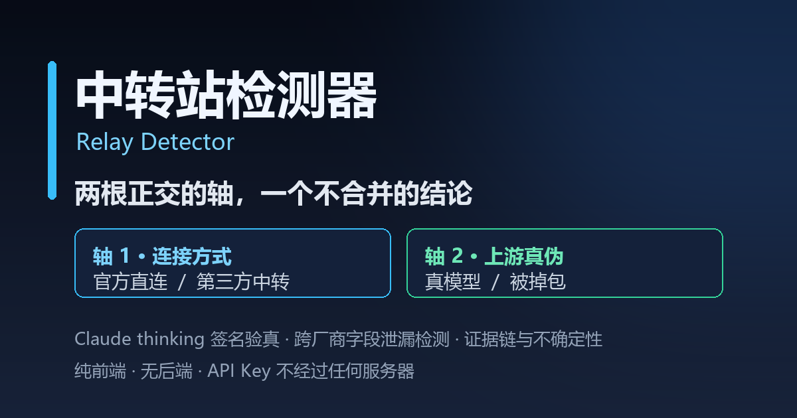

# relay-detector · API 中转站识别器



判断一个 OpenAI 兼容 / Anthropic Claude / Google Gemini 的 API 基址，回答**三个正交的问题**：

| 轴 | 问题 | 输出 |
| --- | --- | --- |
| **连接轴** | 我连的是**官方直连**，还是**第三方中转站**？ | `official` / `likely-official` / `inconclusive` / `likely-relay` / `relay` |
| **真伪轴** | 第三方上游给我的**是不是真模型**？ | `excellent` / `passed` / `marginal` / `failed` / `invalid` |
| **退化轴**（v3） | 我最近用的这个 AI，**能力是不是在下降**？ | `stable` / `suspicious` / `likely-degraded` / `insufficient` |

三根轴**绝不合并成一个分数**，因为它们的结论完全不同：

- `relay` + `passed` → 中转站，但上游是真模型 → **可用**
- `relay` + `failed` → 中转站，且上游疑似被掉包 → **建议更换**
- `official` → 真伪轴无意义（官方直连，无需验真）
- 退化轴 `likely-degraded` → 你自己的历史日志显示**截断率飙升 / 输出变短 / thinking 消失 / 模型被替换**

特点：

- 纯静态、无构建步骤：整个页面就是原生 ESM + 原生 CSS，可直接托管到 GitHub Pages。
- 可选的本地 Node 代理（`proxy/server.mjs`）补上浏览器拿不到的两类证据：**完整响应头**与 **TLS 证书**。
- 桌面端（`desktop/`）内置本地代理，**彻底绕过浏览器 CORS**。
- **不经过任何第三方服务器**：API Key 只在浏览器内存与请求头里；**使用日志只在本地解析，一条都不上传**。
- 不硬编码中转站黑名单，只做**特征**判定；每个结论都附带 `evidence` 与 `confidence`。
- 所有文案为中文；报告明确展示不确定性，**不声称「100% 确定」**。

> 接口契约：[docs/CONTRACT.md](docs/CONTRACT.md)（v1 连接轴 + v2 真伪轴 + v3 退化轴，已冻结）。
> 设计取舍调研：[docs/LEARNINGS-FROM-VERIDROP.md](docs/LEARNINGS-FROM-VERIDROP.md)。

---

## 它回答什么问题

**连接轴**（默认，免费，不需要 Key）：输入 `https://api.example.com/v1`，工具发出**只读**探测
（默认不发送任何会产生费用的对话请求）：

1. 这个域名是官方域名吗？（`api.openai.com` / `api.anthropic.com` / `generativelanguage.googleapis.com`，以及 Azure OpenAI 等模式）
2. 响应头、错误报文、模型列表、TLS 证书里有没有**已知网关软件**或**聚合转发**的特征？
3. 综合来看，更可能是 `relay` / `likely-relay` / `inconclusive` / `likely-official` / `official`？

**真伪轴**（需要你自己的 API Key，会产生真实 token 费用）：向目标发送 7–10 个真实请求，检查：

1. 响应结构是否符合官方协议（id 前缀、`object`、`finish_reason`、`usage` 键）
2. **Claude thinking 签名**是否存在（Anthropic 服务端加密产物，替身网关伪造不出来）
3. 是否有**跨厂商字段泄漏**（例如 OpenAI 响应里出现 `claude_cache_creation_5_m_tokens` → 后端其实是 Claude）
4. 模型字段回显、token 用量自洽性、工具调用、结构化输出、流式一致性

它**不**回答「这家服务商是否可信」「是否违反条款」「延迟与价格如何」。它不是安全审计工具，
更不是法律意见。

---

## 判定原理 · 连接轴（多层指纹）

证据按类别加权：**只有方向性明确的特征才计分**；中性特征只作为展示与解释，不推动结论。

| 类别 | 典型规则 id | 观察对象 | 方向 | 说明 |
| --- | --- | --- | --- | --- |
| `url` | `url.official_host` | 主机名白名单 / Azure 模式 | official | 命中官方域名才给官方分 |
| `url` | `url.nonstandard_port` | 非 443 端口 + 自建网关迹象 | relay | 「非官方域名」**本身不作为中转证据** |
| `tls` | `tls.self_signed` | 证书自签 / 不受信 | relay | 自签证书是自建网关的常见特征 |
| `tls` | `tls.official_issuer` | 签发者属于官方已知 CA（如 Google Trust Services） | official | 仅作**正向**加分 |
| `tls` | `tls.cloudflare_issuer` | Cloudflare / Let's Encrypt / AWS / DigiCert… | **neutral** | 公共 CA 与 CDN 不代表中转（见下） |
| `headers` | `headers.cf_ray` | `server: cloudflare` / `cf-ray` | **neutral** | **官方 Anthropic 端点本身就在 Cloudflare 后** |
| `headers` | `headers.openai_version` | `openai-version: 2020-10-01`、`openai-processing-ms`、`x-request-id: req_…` | official | 官方独有头，中转站一般不会伪造 |
| `error` | `error.openai_shape` | `{"error":{"message","type","param","code"}}` 四字段齐全 | official | 官方错误对象结构 |
| `error` | `error.flat_gateway_envelope` | `{"code":401,"message":"无效的令牌","data":null}` | relay | one-api / new-api 风格扁平业务包装体 |
| `error` | `error.edge_protection` | `403 {"error":{"type":"forbidden","message":"Request not allowed"}}` | **neutral** | 边缘防护拦截，非 API 自身鉴权，**必须判为无法判定** |
| `models` | `models.cross_family` | `/v1/models` 混入 `claude-` / `gemini-` / `qwen-` 等多家家族 | relay | 多上游聚合的强特征 |
| `payload` | `payload.api_path_html` | API 路径返回 HTML / 占位页 | **neutral** | 非 API 端点，说明不了方向 |
| `behavior` | `behavior.latency_outlier` | 延迟异常，符合「再转发一跳」 | relay | 弱证据，受网络影响大 |
| `signature` | `signature.one_api_error_type` | 报文/头部出现已知网关软件指纹 | relay | 集中维护在 `src/core/signatures.js` |

> 实际规则共 71 条，每条 id、权重与 `confidence` 取值理由由 engine 在
> [docs/ENGINE-NOTES.md](docs/ENGINE-NOTES.md) 中逐条说明。

评分数学由 `src/core/score.js` 提供（冻结）：

| 条件 | 判定 |
| --- | --- |
| 无任何方向性证据（`flags.hasDirectionalEvidence=false`） | `inconclusive` |
| 方向分绝对量 `< 15`（`flags.insufficientDirectionalPoints`） | `inconclusive` |
| 证据强度 `evidenceStrength < 0.40` | `inconclusive`（**证据不足，不下结论**） |
| `score >= 70` | `relay` |
| `58 <= score < 70` | `likely-relay` |
| `42 <= score < 58` | `inconclusive` |
| `30 <= score < 42` | `likely-official` |
| `score < 30` | `official` |
| 无 `url` 类官方身份信号却要判 `official` | 强制降级 `inconclusive`（`flags.officialDowngraded`） |

分数是**启发式**的，不是概率。`evidenceStrength` 单独展示，便于看出结论到底有多虚。

### 关键设计结论 1：「响应头像官方」只证明上游是真的，不证明你连的是官方

官方头（`openai-version`、`openai-processing-ms`、`openai-organization`、`x-request-id` 等）
在反向代理下会被**原样透传**：中转站把你的请求转发给官方，官方返回什么头，中转站就回传什么头。
所以「响应头长得像官方」只能说明**它的上游确实是官方实现**，不能说明**你连的就是官方**。

因此本项目以**域名身份**作为直连判定的核心依据，并实现**域名身份降级闸门**：当一次检测中
没有任何 `category: 'url'` 的 official 信号时，即使分数落在 `official` / `likely-official` 区间，
也一律降级为 `inconclusive`。报告里的 `flags.urlIdentityConfirmed`、`flags.officialDowngraded`、
`flags.upstreamLooksGenuine` 会如实标出「上游看起来是真的，但域名身份未确认 ⇒ 很可能正在经由代理访问」。

### 关键设计结论 2：Cloudflare / 公共 CA ≠ 中转站

这是本项目最重要的一条结论，写在 `src/core/constants.js` 的 `CALIBRATION` 里，并有实测支撑：

> **`api.anthropic.com` 官方端点本身就位于 Cloudflare 之后（`server: cloudflare`），
> 并且证书由 Google Trust Services（WE1）签发，而不是 Anthropic 自签。**

本机实测（`node proxy/server.mjs` + `GET /inspect?host=api.anthropic.com`，2026-10-19）：

```text
issuer:  { C: 'US', O: 'Google Trust Services', CN: 'WE1' }
subject: { CN: 'api.anthropic.com' }
protocol: TLSv1.3   cipher: TLS_AES_256_GCM_SHA384   selfSigned: false   daysRemaining: 63
server: cloudflare  cf-ray: …-LAX
403 {"error":{"type":"forbidden","message":"Request not allowed"}}   ← 边缘防护，不是鉴权响应
```

因此：「用了 Cloudflare」「证书是公共 CA 签发」「域名不是官方域名」**三条都不能单独作为中转证据**。
把官方直连误判成中转站，是本项目**最大的失败模式**；宁可输出 `inconclusive`，不要输出错误的 `relay`。

---

## 判定原理 · 真伪轴（v2）

### 三个容易被误解的语义（最重要）

1. **`skip` 不算 0 分。** 检测器状态有四种：`pass` / `fail` / `skip` / `error`。
   只有 `pass` 与 `fail` 进入加权分母；`skip`（本来就无法测，例如模型不支持 thinking）与
   `error`（网络/上游报错）**都不计入**。否则「模型不支持 thinking」会被冤枉成「中转站吞掉了 thinking」。
2. **`critical` 一票降级。** 任意检测器报出 critical 级问题，结论就由 `passed` 封顶为 `marginal`
   —— 分数可能仍然很高（一条 20% 权重的致命项会被多条 100 分的廉价结构项淹没），但结论必须降级。
3. **「检测无效」≠「未达标」。** 余额不足、`model_not_found`、无可用渠道时，报告 verdict 为
   `invalid`（灰色「检测无效」+ 换 Key / 换模型建议），**不会**给你一个低分让你以为这家站很烂。

### 10 个检测器

| 检测器 | 权重 | 档位 | 说明 |
| --- | --- | --- | --- |
| `protocol_shape` | 20 | quick+ | 响应结构是否符合官方协议 |
| `cross_vendor_leak` | 20 | quick+ | **critical**：跨厂商字段泄漏 |
| `model_consistency` | 15 | quick+ | 模型字段回显 + 3 次采样 token 变异系数 |
| `thinking_signature` | **25** | standard+ | **只有 Claude 有**：服务端加密签名验真 |
| `message_id` | 5 | standard+ | `msg_` / `toolu_` / `srvtoolu_` 前缀规范 |
| `token_usage` | 10 | standard+ | usage 自洽性（字符/token 比、是否超上限） |
| `structured_output` | 10 | standard+ | 要求精确 JSON，检查是否被包 ```json |
| `capability_tools` | 10 | standard+ | 工具调用是否真实生效 |
| `stream_integrity` | 10 | full | 流式 vs 非流式文本/用量一致性 |
| `token_parity` | 10 | full | 与内置官方基线对齐（无基线则 skip，不扣分） |

评分：`总分 = Σ(分数 × 权重) / Σ(权重)`（仅统计 `pass`/`fail`）。
`≥85 优秀` / `≥70 通过` / `≥50 基本合格` / `<50 未达标`。

### 为什么 `thinking_signature` 是最硬的证据

Claude 开启扩展思考时，响应 `content[]` 里的 `thinking` / `redacted_thinking` 块会带一个
**Anthropic 服务端生成的 `signature`**（实测数百到两千余字符）。它需要 Anthropic 的私钥才能产生。

- **Kiro / Amazon Q / 部分 Bedrock 通道**走的是简化接口，**根本不返回该签名**
  → 拿不到签名 = 上游不是「真 Claude」的强证据。
- 判定：无 thinking 块 = 0 分；有块无签名 = 30；签名过短（<50 字符）= 70；正常 = 100。
- 实现细节（踩坑点，均已处理）：必须用**非流式**请求（流式 + adaptive 会静默丢 thinking 块）；
  `max_tokens` 要给足（16000），否则模型会为了塞下而直接不思考；探针用多步欧几里得 GCD
  而非简单乘法，避免被固定题面特判。

> 需要强调的是：签名能证明「上游是真实 Anthropic 实现」，**不能**证明「模型是满血版 / 未被降智」。
>
> **v2.1 起，签名缺失是 `critical` 而非普通扣分**：如果模型明确支持 thinking、我们也明确请求了
> thinking，却拿不到服务端签名，那么「其余所有协议字段都正确」也不能救它。
> 否则一条 25% 权重的致命项会被 7 条 100 分的廉价结构项淹没，冒充者会被判「通过」。
> 模型本身不支持 thinking（如 haiku）时仍是 `skip`，**绝不会**误报 critical，也不会拉低总分。

### 三档深度与费用

| 档位 | 请求数 | 用途 |
| --- | --- | --- |
| `quick` | 4 | 快速摸排协议与跨厂商泄漏 |
| `standard` | 7（OpenAI/Gemini）/ 8（Anthropic） | **默认推荐**，含 thinking 签名 |
| `full` | 9 / 10 | 增加流式一致性与基线对齐 |

界面会在**发请求前**展示 `estimateCost()` 的请求数与 token 预估，并要求你**显式勾选确认**；
每次检测结束后勾选会自动重置，避免误重复扣费。费用由你的 API Key 直接支付给目标服务商。

---

## 判定原理 · 退化轴（v3，基于你自己上传的使用日志）

### 先说清楚它不是什么

**这不是 IQ 测试，也不是「能力测量」。** 日志里没有「答案正确性」这个字段，
所以任何工具都无法从日志直接证明「模型变笨了」。

它做的是：从你的日志里提取**可观测的行为信号**，把时间轴切成**早期 / 近期**两段，
比较指标是否发生了**系统性变化**，并给出「有/没有退化迹象」的统计判断。

### 它会看什么（13 个指标）

| 指标 | 变差的信号 | 说明 |
| --- | --- | --- |
| **截断率** | `finish_reason=length/max_tokens` 占比上升 | 输出被硬截断，最典型的「能力被削」表现 |
| **模型替换** | 响应的 `model` 与请求的模型不一致 | 请求 Opus 却返回更便宜的型号 |
| **thinking 存在率 / 占比** | 从有到无、或占比骤降 | 中转站关掉思考、或换成不支持思考的通道 |
| **输出长度** | 中位数下降 | 回答变短（也可能是任务变了，需结合其它指标） |
| **token 膨胀** | 字符数/输出 token 下降 | 同样内容被多算 token |
| **延迟** | 中位数上升 | 多了一跳转发、或上游降级 |
| **错误率 / 拒答率 / 空回答率 / 重复率** | 上升 | 稳定性退化 |
| **缓存命中率** | 下降 | 可能换了渠道 |

只有**数据足够**的指标才参与评分；数据不足的直接标「数据不足」并**不进分母**
（与真伪轴的 `skip` 同源，避免把「测不了」当成「变差了」）。

### 三个必须理解的语义

1. **样本不足 ≠ 稳定**：有效记录少于 20 条、或可用指标少于 3 个时，结论是
   **`insufficient`（无法判断）**，而不是「未见退化」。
2. **critical 一票定案**：模型被替换、截断率 >15% 且翻 5 倍、thinking 从 >50% 掉到 ≈0，
   任意一条成立即判 `likely-degraded`，不管其它指标多好看。
3. **「检测无效」与「未达标」分开**：样本不够只显示灰色「无法判断」，不会给你一个误导性的低分。

### 支持哪些日志

Claude Code 会话日志、你自己保存的 API 请求/响应日志（JSON/JSONL）、
中转站用量/账单 CSV、ChatGPT 官方导出 `conversations.json`。
格式由**内容自动识别**（改名成别的扩展名也能认）。详见 [docs/LOG-FORMATS.md](docs/LOG-FORMATS.md)。

### 隐私（这条是硬的）

**日志一条都不上传。** 用 `FileReader` 在浏览器内存里解析，零网络请求；
报告里只有计数、比率、中位数、模型名，**没有原文，也没有文件名**。
想看效果但不想用真实日志？先生成一套合成日志：

```powershell
npm run logs:gen          # 生成 samples/ 下的 stable / degraded 两套假日志
npm run accept:degrade    # 命令行直接验收整条链路
```

---

## 局限性（必读）

### 连接轴

1. **浏览器模式受 CORS 限制**：跨域请求默认拿不到完整响应头；`cf-ray`、`openai-version`、
   `anthropic-ratelimit-*` 这类头经常被过滤，甚至完全读不到。预检失败时请求根本不发出。
2. **浏览器无法读取 TLS 证书**：JavaScript 没有访问 peer certificate 的能力，
   所以 `tls.*` 规则在浏览器模式下恒为空。要看证书必须用本地代理。
3. **Cloudflare / 公共 CA / 非官方域名 ≠ 中转站**：见上文实测校准。这是本项目最容易被误用的地方。
4. **边缘防护响应必须判为「无法判定」**：`403 {"error":{"type":"forbidden","message":"Request not allowed"}}`
   是 CDN/WAF 的拦截，不是 API 自身鉴权，也不是中转证据。
5. **聚合平台与灰产中转不同**：`openrouter.ai` 一类平台本质就是多上游代理，是公开的商业模式，
   与「伪装成官方的灰产中转」不是一回事；报告用词会区分，但判断仍可能让使用者不适。
6. **CDN / 共享 IP 不可作为证据**：同一 CDN 上既有官方也有中转站，IP 段、ASN、延迟都不足以定性。

### 真伪轴

7. **真伪轴只能给「强弱证据」，不是数学证明。** 除了 Claude 的 thinking 签名接近「不可伪造」，
   OpenAI / Gemini 协议本身**没有**等价的加密防伪码，所以只能做「协议级 / 行为级」判断，
   可能漏判高水平的模型替换（尤其是「旗舰换小模型」这类同厂降级）。
8. **成熟中转站可以关闭品牌特征、伪造官方头、改写响应结构。** `signature` 与 `headers` 类规则会被绕过；
   反代 vs 直连只能靠域名身份，工具无法读取 DNS / 真实路由。
9. **`token_parity` 默认恒为 skip**：内置基线会随模型与分词器更新而过期，硬编码会制造假阳性，
   所以本项目**没有**可信基线时选择跳过而不是扣分。这是刻意的保守设计。
10. **长上下文真实性检测未实现**：宣称 1M 上下文实际只给 200k 这类欺诈，需要发 32k→500k→950k
    的超大请求（单次可能 $3–$15），本项目默认不发送。需要时可自行用 `detect()`/`runAuthenticity()`
    的 API 扩展，或改用带后端与持续探测的服务（如 veridrop.app）。
11. **没有红黑榜 / 历史趋势 / 持续监测**：这些需要后端与数据库。本项目定位是
    「**本地可审计的单次检测**」——反过来，好处是你的 Key 与报告从不离开你的浏览器。
12. **不做「身份问句」当主判据**（问模型「你是谁」）：中转站可以注入 system prompt 让它自称 Claude。
    本项目只把行为/身份类信号当极弱辅助。
13. **检测会消耗真实额度**：`standard` 档约 8 个请求、含 thinking 的长输出。请用小额 Key 测试。

### 退化轴（v3）

14. **日志无法证明「智力下降」。** 日志里没有答案正确性，只能观测**行为变化**。
    「输出变短」既可能是降智，也可能是你的任务变简单了、系统提示词改了、缓存策略变了。
    因此结论永远是「统计上存在系统性变化的迹象」，请结合上下文读。
15. **需要足够的历史跨度才有意义。** 同一小时内的一批日志只能做整体统计，
    无法判断趋势；建议至少跨越几天、有效记录 ≥ 200 条。
16. **对「换模型」的检测依赖日志里同时有请求模型与响应模型**；
    很多客户端日志只记响应模型，这时只能看模型集合是否变化（信号更弱）。
17. **账单/用量 CSV 缺 thinking 与正文**，`thinking_*`、`refusal_rate`、`repetition_rate`
    等指标会自动「数据不足」并**不参与评分**（不会因此误判）。
18. **无法识别「同厂静默降级」**（例如同一个模型名背后换成更小的版本、或路由到不同区域），
    除非日志本身记录了模型版本或 token 分布发生明显变化。
19. **不做跨用户基准对比**：本项目纯本地，没有别人的数据可参照，
    所以只能说「你自己的前后期是否变化」，不能说「你是否比行业平均差」。

### 通用

20. **本机网络受限导致的证据缺失**：开发环境实测仅 `api.anthropic.com` 可达，
    `api.openai.com` 与 `generativelanguage.googleapis.com` 不可达；因此部分官方头/证书事实
    是「高置信常识」而非本机实测，`confidence` 取值偏保守（0.5~0.65）。
21. **分数不是概率**：权重与阈值是人为设定的启发式，跨网络环境可能偏差。
22. **不做请求内容的隐私审计**：代理会把你提供的 Key 原样转发给目标（必须如此才能拿到真实响应），
    请自行确认目标可信。
17. **HTTPS 页面 → `http://127.0.0.1` 可能被混合内容策略拦截**：部分浏览器在 HTTPS 页面上
    会拦截到 `http://127.0.0.1:8787` 的请求。推荐直接用代理自己托管的页面
    （<http://127.0.0.1:8787/>）做检测。

**结论必须带不确定性一起读。** 报告里的每条信号与每个检测器的 `subChecks` 都可以展开看原始证据，
我们鼓励你按证据自己判断，而不是只看那个大徽章。

---

## 快速开始

三种深度，页面本身不需要任何构建步骤。

> 完整的**上线与分发方案**（GitHub Pages / 自定义域名 / 浏览器扩展 / 云端探测 API 的取舍与安全红线）
> 见 [docs/DEPLOY.md](docs/DEPLOY.md)。

### 方式 A：GitHub Pages（纯浏览器，零安装）

1. Fork / 克隆本仓库。
2. 仓库 Settings → Pages → Build and deployment → Source 选 **GitHub Actions**。
3. 推送到 `main`，`.github/workflows/pages.yml` 会先跑测试再部署仓库根目录。
4. 打开 Pages 地址，填入 API 基址 → 选检测深度 → 点「开始检测」。

> 静态站是 HTTPS，若要用本地代理模式，浏览器可能因混合内容拦截 `http://127.0.0.1`；
> 这种情况请改用方式 B（由代理自己托管页面）。

### 方式 B：本地代理（推荐，能读 TLS 与完整响应头）

```bash
git clone <this-repo>
cd relay-detector
node proxy/server.mjs            # 默认 http://127.0.0.1:8787
```

> Windows PowerShell 5.1 **不支持 `&&`**，请把命令分两行写（或在 PowerShell 7 / cmd / Git Bash 里用 `&&`）。

然后浏览器打开 <http://127.0.0.1:8787/>，模式选「本地代理」。

接口自测：

```bash
curl "http://127.0.0.1:8787/health"
curl "http://127.0.0.1:8787/inspect?host=api.anthropic.com&port=443"
curl "http://127.0.0.1:8787/proxy?url=https%3A%2F%2Fapi.anthropic.com%2Fv1%2Fmodels"
```

详细路由、响应头语义与参数见 [proxy/README.md](proxy/README.md)。

### 方式 C：桌面端（推荐给普通用户，能绕过 CORS）

桌面端在本机进程发请求，因此**完全不受浏览器 CORS 限制**，并能读完整响应头与 TLS 证书。
两种形态，共用同一套代码与同一个本地代理：

```powershell
# 零依赖启动器：双击 desktop\launch.cmd，或
npm run desktop

# Electron 原生窗口（首次需装一次依赖）
npm run desktop:electron
```

启动器会自动打开浏览器并**预置为「本地代理」模式**，端口自动分配（不会和 8787 冲突）。
详见 [desktop/README.md](desktop/README.md)。

---

## 隐私与安全

**本项目是纯前端，没有任何后端服务器。**

- **API Key 不会上传到第三方**：它只存在于你的浏览器内存与发往**目标站**的请求头里。
  使用本地代理模式时，Key 最多到你自己的 `127.0.0.1`。
- **默认不落盘**：只有你显式勾选「保存密钥到本机」才会写入 `localStorage`；
  页面提供「立即清除 Key」按钮。
- **报告不外传**：没有上报端点、没有遥测。检测历史只存 host / 模型 / 两轴结论 / 时间，
  **绝不存 Key，也不存报告正文**。
- **报告内 Key 一律脱敏**（保留前 4 + 后 4），包括上游把 Key 回显在错误报文中的情况。

> 对比：带有红黑榜/持续监测的服务必须接收并保管你的 Key（哪怕是加密的）。
> 本项目放弃这类功能，换取「Key 与结论都留在本地」。请按你的风险偏好选择。

### 本地代理安全说明

代理是在**你自己机器上**运行的、只绑定环回地址的辅助进程。它的设计目标是「不成为新的攻击面」：

- **只允许 `http` / `https`**，`file:` / `gopher:` / `data:` 等一律拒绝。
- **默认拒绝私网 / 环回 / 链路本地 / CGNAT 目标**：`10/8`、`172.16/12`、`192.168/16`、`127/8`、
  `169.254/16`、`100.64/10`、`::1`、`fc00::/7`、`fe80::/10` 等，命中返回 `403 private_target_blocked`。
- **防 DNS 绕过**：先解析全部 A/AAAA，任一非公网即整体拒绝；连接时把 `lookup` 固定到已校验 IP。
- **重定向逐跳校验**：302 指向内网或 `file:` 都会被拦。
- **资源上限**：请求体 1 MiB、响应体 2 MiB（超出截断并打标）、单跳与总超时、并发上限。
- **密钥零落盘**：代理不写文件；日志中 `authorization` / `x-api-key` 等只留前 6 位，URL 中的
  `api_key` / `token` 替换为 `<redacted>`。
- **`--allow-private` 是危险的调试开关**，**不要**与 `--host 0.0.0.0` 同时使用。
- **证书不校验**（`rejectUnauthorized: false`）：为观测自签/过期证书而刻意如此，可信性通过
  `authorized` / `authorizationError` 暴露。

> 把本代理暴露到公网等于开放一个 SSRF 跳板，并且会把使用者的 API Key 转发到任意地址。请不要这样做。

---

## 目录结构

```text
.
├─ index.html                      页面骨架（原生 ESM，无构建）
├─ assets/og-cover.png             社交分享卡片（1200×630）
├─ desktop/                        桌面端
│  ├─ launch.cmd / launch.mjs      零依赖启动器（只需 Node，双击即用）
│  ├─ main.mjs                     Electron 外壳（进程内复用本地代理）
│  └─ README.md                    两种桌面形态、打包与安全说明
├─ src/
│  ├─ core/
│  │  ├─ constants.js              常量与校准事实（冻结，只读）
│  │  ├─ score.js                  连接轴评分数学与三类闸门（冻结，只读）
│  │  ├─ engine.js                 detect() 探测编排 + 两轴组装
│  │  ├─ probes.js                 ProbeSpec 执行器（脱敏 / 截断 / 超时）
│  │  ├─ signatures.js             已知网关软件指纹
│  │  ├─ rules/                    连接轴规则（url/tls/headers/error/models/payload/behavior/signature）
│  │  ├─ auth/                     v2 真伪轴
│  │  │  ├─ index.js               runAuthenticity / estimateCost / AUTH_MODES（公开 API）
│  │  │  ├─ scorer.js              加权平均 / critical 封顶 / 致命错误识别
│  │  │  ├─ runner.js              档位编排、maxRequests 硬上限、密钥 scrub
│  │  │  ├─ models.js              模型能力表（thinking 支持等）
│  │  │  ├─ protocol.js            三协议请求构造与响应解析（纯逻辑）
│  │  │  └─ detectors/             10 个真伪检测器
│  │  └─ degrade/                  v3 退化轴（降智诊断）
│  │     ├─ index.js               parseLogFiles / analyzeDegradation（公开 API）
│  │     ├─ parsers/               5 种日志格式解析 + 内容自动识别
│  │     ├─ metrics/               13 个指标（截断率/模型替换/thinking/长度/token 膨胀…）
│  │     ├─ segment.js             前后期切分与变化点探测
│  │     └─ scrub.js               隐私剥离（报告里绝不含原文/文件名）
│  ├─ providers/                   openai.js / anthropic.js / gemini.js
│  ├─ ui/                          app.js / render.js / components.js / authenticity.js / form-state.js / auth-api.js
│  └─ styles/main.css
├─ proxy/                          本地代理（TLS 证书读取 + 透传 + SSRF 防护）
├─ test/                           Node 内置测试 + 离线 fixture
├─ tools/
│  ├─ check.mjs                    命令行验证工具（--demo 零依赖自证 / 验你自己的站）
│  ├─ gen-sample-logs.mjs          生成合成日志（5 种格式 × stable/degraded，可安全分享）
│  ├─ acceptance-degrade.mjs       退化轴端到端验收（30 项断言）
│  ├─ acceptance.mjs               连接轴端到端验收（真实 HTTP 假中转站）
│  ├─ acceptance-auth.mjs          真伪轴端到端验收（模拟真 Claude / 冒充 / 跨厂商泄漏 / 无渠道）
│  └─ fingerprint-official.mjs     官方端点指纹采集（匿名，不消耗额度）
├─ docs/
│  ├─ LOCAL-VERIFICATION.md        本地验证指南（逐层步骤 + 预期输出 + 排错）
│  ├─ LOG-FORMATS.md               支持的日志格式、字段提取、脱敏样例、扩展方法
│  ├─ DEPLOY.md                    上线与分发（双托管 / 桌面端 / CORS 方案 / 安全红线）
│  ├─ CONTRACT.md                  接口契约（v1 连接轴 + v2 真伪轴 + v3 退化轴，已冻结）
│  ├─ ENGINE-NOTES.md              71 条规则依据与置信度
│  ├─ AUTH-NOTES.md                10 个真伪检测器算法与阈值
│  ├─ DEGRADE-NOTES.md             13 个退化指标口径、阈值来源与局限
│  ├─ DEGRADE-REVIEW.md            v3 独立复核报告（171 项断言 + 4 条改进建议）
│  └─ LEARNINGS-FROM-VERIDROP.md   调研结论与取舍
└─ .github/workflows/pages.yml     测试 + GitHub Pages 部署
```

## 开发与测试

> **完整的本地验证步骤（含每层的预期输出与排错）见
> [docs/LOCAL-VERIFICATION.md](docs/LOCAL-VERIFICATION.md)。**
> 最省事的一条：`npm run verify`（测试 + 真伪轴验收 + 冒充场景冒烟）。

```bash
npm run verify                    # 一键验证（推荐）
npm test                          # 单元 + 契约 + 离线 fixture（237 项，无需联网）
                                  # = node --test "test/**/*.test.mjs"
npm run logs:gen                  # 生成 samples/ 下的合成日志（5 种格式 × stable/degraded）
npm run accept:degrade            # 退化轴端到端验收（30 项断言，不联网）
node tools/check.mjs --demo kiro  # 零依赖自证：模拟冒充 Claude（不需要任何 Key）
node tools/acceptance-auth.mjs    # 真伪轴端到端验收（本地假中转站，不联网）
node tools/acceptance.mjs --live  # 连接轴端到端验收（含真实 api.anthropic.com）
node proxy/server.mjs             # 本地起代理并托管页面
node tools/fingerprint-official.mjs --json   # 重新采集官方端点指纹（匿名）
```

> ⚠️ **不要写成 `node --test test/`**：Node 24 会把目录位置参数当作模块去 require，
> 报 `Error: Cannot find module '.../test'` 并以 exit 1 结束，**一个测试都不会跑**。
> 正确写法是 `npm test`（即 `node --test "test/**/*.test.mjs"`，glob 展开需要 Node 21+）。

CI（`.github/workflows/pages.yml`）在部署前先跑 `npm test`；若仓库里没有测试文件会优雅跳过。

**不使用任何运行时依赖**：只有 Node 内置模块与浏览器原生 API。`package.json` 里没有 `dependencies`。

## 免责声明

- 本工具只做**特征推断**，输出是启发式判断，**不是事实认定**，也不构成对任何服务商的指控或背书。
- 请仅对你**有权访问**的端点使用本工具；不要用它扫描或攻击他人系统。
- 真伪检测会向目标发送真实请求并**产生费用**，由你的 API Key 支付。
- API Key 由使用者自行提供与保管。代理会把 Key 转发给目标端点，请确认目标是你要检测的对象。
- 因使用本工具产生的任何直接或间接后果（包括误判、额度消耗、账号风险、合规问题），
  作者与贡献者不承担责任。
- 本项目与 OpenAI、Anthropic、Google 或任何中转/网关软件项目均无隶属或关联关系。

## 许可

[MIT](LICENSE) © 2026 relay-detector contributors
